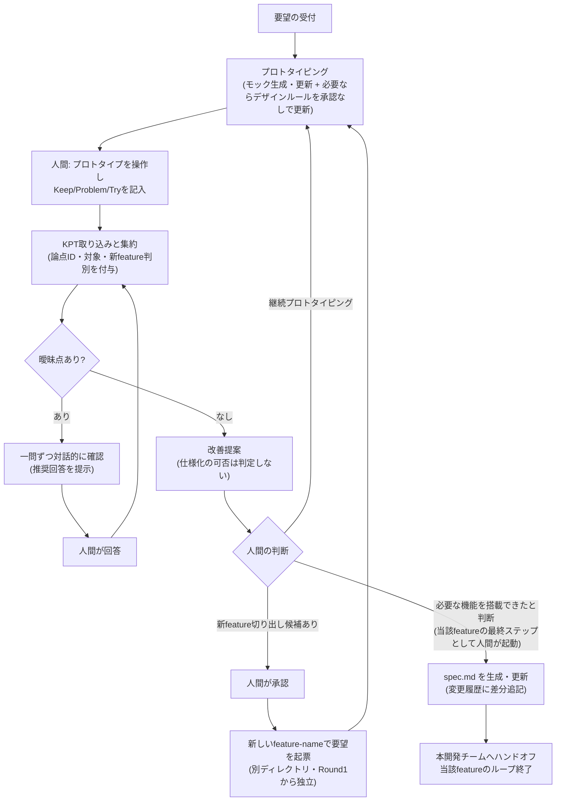

# プロトタイプ駆動KPTフローの手順書（ツール非依存）

GitHub Copilot Coding Agentという実装手段に依存しない、プロセス自体の説明です。別のツールでこのプロセスを再現する場合はこの文書を参照してください。

具体的なファイル形式・列挙値は各skillファイルとAGENTS.mdを正本とし、ここでは重複定義しません。本書は「何のためにこの手順があるか」と「複数ラウンド・複数featureをどの順で回すか」に焦点を当てます。

## サイクル

1. **要望の受付**: シンプルな要望を受け付ける。
2. **プロトタイピング**: 要望または前回の改善提案をもとに、画面操作可能なモックを作る。実データ・永続化・認証等は簡略化してよく、簡略化した点は必ず記録する。初回では準拠する基本デザインシステム（外部標準・基本トークン）を宣言・記録する。デザインルールが固まった／変わったラウンドでは、feature独自のデザインルールを**承認なしで適宜**更新する。
3. **KPTレビュー**: プロトタイプに触れた人間が Keep / Problem / Try を表（スプレッドシート等）または自由文で記入する。
4. **KPT取り込みと集約**: 取り込んだKPTを、機能カテゴリ別の論点IDを付けたワイド形式（1論点=1行）の表に集約する。論点IDはラウンドをまたいで再利用する。あわせて各論点に「仕様の話か／デザインルールの話か」の区別と、「既存feature改善か／新feature切り出しか」の判別を付与する（迷う場合は仕様／既存feature改善を既定）。集約結果は論点ごとの最新スナップショットとして保持し、ラウンドごとの観測は削除・改変しない履歴として残す。
5. **曖昧点の解消**: 曖昧な点があれば、一問ずつ対話的に（推奨回答を添えて）掘り下げて確認する。件数の上限は設けず、同一セッション内で曖昧点がなくなるまで改善提案には進まない。
6. **改善提案**: Try起点で改善案を提示する。スコープを超える論点があれば新feature切り出し候補もあわせて提示する（実行は人間の判断・承認後）。**仕様化すべきかの判定・提案は行わない**。
7. **分岐**:
   - 継続プロトタイピング（通常）: 改善提案を手順2への入力とし、サイクルを繰り返す。
   - 新feature切り出し: 人間の承認後に新しいfeature-nameで要望を起票し、別ディレクトリとして手順1から新サイクルを開始する。元featureのサイクルはそのまま継続する。
8. **仕様化とハンドオフ（当該featureの最終ステップ）**: **人間が「必要な機能を搭載できた」と判断したとき**にのみ、明示的な起動でシステム非依存の仕様書を生成・更新する。仕様書は仕様（WHAT）のみを記録し、デザインルールは混ぜない。収束度などの自動判定では起動しない。生成後は本開発（実装）チームへハンドオフし、当該featureのプロトタイピング/KPTループはここで終了する。

## 設計思想

- **曖昧なまま次工程に進めない**: 人間の記述は省略されがちなため、解釈違いによる手戻りを防ぐ目的で曖昧点の解消を必ず挟む。
- **specを起こすのは人間の判断**: 自動化された収束判定で仕様書を起こさない。
- **デザインルールは承認なしで適宜更新**: 見た目・操作感のルールはプロトタイピングの中で自然に固まるため、承認ゲートを設けない。
- **仕様化を当該featureのゴールとする**: spec.mdの生成は当該featureのラウンドの最終ステップであり、生成後は本開発チームへハンドオフしてプロトタイピング/KPTループを終了する。

## サイクル全体像

登場する「役割」は実装手段に依存しません（Coding Agent運用では`prototype-agent`/`kpt-agent`/`spec-writer`に対応）。

## 成果物ごとの生成主体・タイミング

| 成果物 | 生成主体 | タイミング | 人間の承認 |
|---|---|---|---|
| モック（コード） | prototype-agent役 | 毎ラウンド | 不要 |
| docs/design.md（基本デザインシステム） | prototype-agent役 | 初回セッション | 不要 |
| prototype-notes.md | prototype-agent役 | 毎ラウンド（追記） | 不要 |
| rule.md（feature独自のデザインルール） | prototype-agent役 | デザイン判断が固まった／変わったラウンド | 不要 |
| kpt-summary.md | kpt-agent役 | 毎ラウンド | 不要 |
| clarification-log.md | kpt-agent役 | 曖昧点があるとき | 不要 |
| spec.md（仕様） | spec-writer役 | 人間が「必要な機能を搭載できた」と判断したとき（当該featureの最終ステップ） | **必要（明示起動）** |

`spec.md`と`rule.md`の非対称性（specは人間の判断で確定、ruleは承認なしで適宜更新）が本フローの要点です。

## 複数ラウンド・複数featureの運用

**ラウンド番号はfeature-nameごとに独立したカウンタ**です。1ラウンド = 1回のKPT記入 → 1回の`kpt-agent`役呼び出しが基本単位で、集約結果は「最新スナップショット（上書き）」と「ラウンド履歴（追記専用）」の2つを持ちます。

- **ケースA: 同一featureの反復（基本）**: プロトタイプを試す → `roundN.csv`を用意 → 同じfeature-nameで`kpt-agent`役を起動 → 曖昧点があれば回答後に改善提案 → 改善提案を入力に`prototype-agent`役でモック更新 → 次ラウンドへ。呼び出し順は常に prototype-agent → kpt-agent で、feature-nameは変えない。
- **ケースB: 新feature切り出し**: `kpt-agent`役が候補を提示するのみ（自動では何も作らない）。人間が承認して新しいfeature-nameで要望を起票し、`prototype-agent`役を新feature-nameで起動する。新featureはRound1から独立して始まり、既存featureのループは並行して続く。
- **ケースC: 仕様化後の継続**: `spec.md`生成後もプロトタイピングとKPTは止まらない（手順はケースAと同じ）。新たな課題は履歴に追記されるだけで`spec.md`はすぐには変えず、人間が仕様更新を判断した時点で`spec-writer`役を**再起動**し、旧内容を消さずに差分を追記する。
- **ケースD: 並行運用時の切り替え**: 起動時に**必ずfeature-nameを指定**する。feature-nameは`docs/specs/<feature-name>/`配下のみを読み書きする一意のキーで、ディレクトリを跨いだ状態は共有されない。指定を誤ると別featureを誤って更新するため、起動のたびに確認する。
