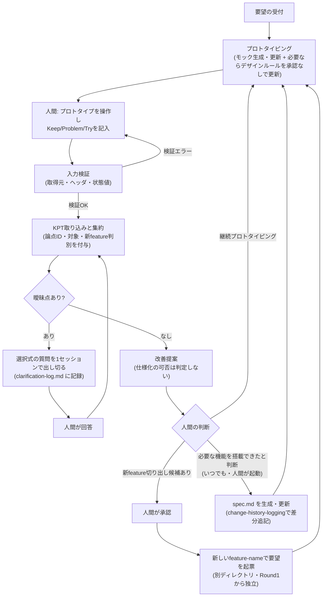
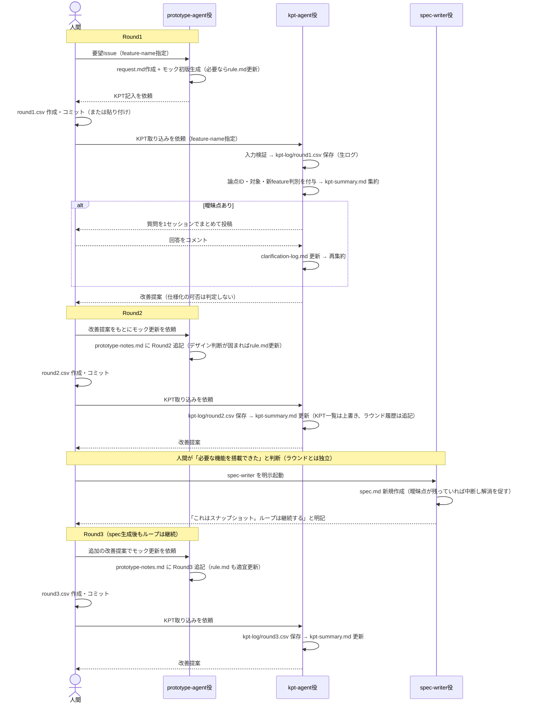

# プロトタイプ駆動KPTフローの手順書（ツール非依存）

この文書は、GitHub Copilot Coding Agentという実装手段に依存しない、プロセス自体の説明です。将来的に別のツールでこのプロセスを再現する場合はこの文書を参照してください。

具体的なファイル形式・列挙値は各skillファイル（`kpt-parsing` / `ambiguity-detection`）とAGENTS.mdを正本とし、ここでは重複定義しません。本書は「何のためにこの手順があるか」と「複数ラウンド・複数featureを扱うときにどの順で何を呼ぶか」に焦点を当てます。

## サイクル

1. **要望の受付**: シンプルな要望を受け付ける。
2. **プロトタイピング**: 要望または前回の改善提案をもとに、画面操作可能なモックを作る。実データ・永続化・認証等は簡略化してよい。簡略化した点は必ず記録する。あわせて、そのラウンドで見た目・操作感のデザインルールが固まった／変わった場合は、デザインルール（rule.md相当）を**承認なしで適宜**更新する。
3. **KPTレビュー**: プロトタイプに触れた人間が、Keep（良い点）/Problem（課題）/Try（次に試すこと）を、種別・機能カテゴリ・内容・状態の列を持つ表（スプレッドシート等）で記入する（種別ごとに1行）。
4. **入力検証**: 取り込んだKPTのCSVは、取得元（コミット済みパス／貼り付け）の少なくとも一方が揃っているか、ヘッダ列とカラム順、種別ごとの状態の許容値を集約前に検証する。検証エラーは値を推測・補正せず、入力元・行・列・値を示して処理を中断する。
5. **KPT取り込みと集約**: 検証を通過したKPTを構造化データ（CSV）として取り込み、機能カテゴリ別の論点IDを付けたワイド形式（1論点=1行、Keep/Problem/Tryを各列に束ねる）の表に集約して重複や矛盾を整理する。論点IDは取り込み時に付与し、ラウンドをまたいで同一論点を追跡できるよう再利用する。あわせて各論点が「仕様（WHAT）」の話か「機能独自のデザインルール（見た目・操作感）」の話かの区別（対象）を付与し、さらに各論点が既存feature改善か新featureとして切り出すべきかを判別する。区別・判別も取り込み時に付与し、迷う場合は仕様／既存feature改善を既定とする。対象は改善提案の整理と成果物の振り分けに使い、仕様化の可否判定には使わない。集約結果は論点ごとの最新スナップショットとして保持し、ラウンドごとの観測は別途、削除・改変しない履歴として残す。
6. **曖昧点の解消**: 集約結果に曖昧な点（範囲・優先度・対象者・成功基準の不明確さ、仕様/デザインの区別不能、既存feature改善/新featureの判別不能、既存デザインルールとの矛盾）があれば、件数で打ち切らず必要な質問をすべて1回のセッションでまとめて選択式で確認する。曖昧点がなくなるまで改善提案には進まない。
7. **改善提案**: Try起点で改善案を提示する。既存featureのスコープを超える論点があれば新feature切り出し候補もあわせて提示する（実行は人間の判断・承認後）。**仕様化すべきかどうかの判定・提案は行わない**（specを起こすかは人間が判断する）。
8. **分岐**:
   - 継続プロトタイピング（通常）: 改善提案を次のプロトタイピング（手順2）への入力とし、サイクルを繰り返す。プロトタイピングは既存のデザインルールがあればそれに準拠し、必要なら承認なしでデザインルールを更新する。
   - 新feature切り出しの場合: 人間が承認したうえで、新しいfeature-nameで要望を起票し、別の成果物ディレクトリとして手順1から新たなサイクルを開始する。元featureのサイクルはそのまま継続する。
9. **仕様化（人間の判断でいつでも）**: **人間が「必要な機能を搭載できた」と判断したとき**に、人間の明示的な起動でシステム非依存の仕様書（spec.md相当）を生成・更新する。仕様書は仕様（WHAT・機能要件）のみを記録し、見た目・操作感のデザインルールは混ぜない（可搬性のため。デザインルールはrule.md相当に分離する）。この判断はラウンドの進行とは独立しており、収束度などの自動判定によっては起動しない。
10. **仕様化後も継続**: 仕様書の生成はプロセスの終了ではなく、その時点のスナップショットである。以降もプロトタイピングとKPTは続き、仕様書との差分は変更履歴として記録し続ける。デザインルールも各ラウンドで承認なしに更新し続ける。

## 設計思想

- **曖昧なまま次工程に進めない**: 人間の記述は省略されがちなため、解釈違いによる手戻りを防ぐ目的で、曖昧点の解消を仕様化の前工程に必ず挟む。
- **specを起こすのは人間の判断**: 「必要な機能を搭載できた」と人間が判断したときにのみ仕様書を確定する。自動化された収束判定で仕様書を起こさない。
- **デザインルールは承認なしで適宜更新**: 見た目・操作感のルールはプロトタイピングの中で自然に固まっていくため、承認ゲートを設けず、プロトタイピング役が各ラウンドで適宜更新する。
- **仕様化をゴールにしない**: プロトタイプとKPTのループは仕様化後も継続し、仕様書は都度更新されるスナップショットとして扱う。

---

## サイクル全体像（フローチャート）

登場する「役割」は実装手段に依存しません（Coding Agentでは`prototype-agent`/`kpt-agent`/`spec-writer`という具体的なagentに対応します）。

ポイント:
- `J`（人間の判断）から`B`（プロトタイピング）へ戻る矢印が複数あるとおり、**「継続」「新feature切り出し」「仕様化」のいずれの分岐でも、元のfeatureおよび新featureのプロトタイピング/KPTループは止まらない**。
- 仕様化（`M`）はループから抜ける終端ではなく、単に`spec.md`という成果物が更新されるだけで、その後も`B`に戻って回り続ける。
- デザインルール（rule.md相当）は`B`のプロトタイピングの中で承認なしに更新されるため、このフローチャートに独立した承認ノードを持たない。

---

## ラウンドごとのagent呼び出し（シーケンス図）

1つのfeatureについて、Round1〜Round3の間にどの役割がいつ呼ばれるかを示します（Coding Agent運用ではそれぞれ`prototype-agent`/`kpt-agent`/`spec-writer`に対応）。

読み取り方:
- `K`（kpt-agent役）は**毎ラウンド必ず呼ばれる**（KPTが記入されるたび）。ただし仕様化の可否は判定しない。
- `S`（spec-writer役）は**人間が「必要な機能を搭載できた」と判断して明示起動したときだけ**呼ばれ、`spec.md`のみを生成・更新する（`rule.md`は扱わない）。
- `rule.md`（デザインルール）は`P`（prototype-agent役）がデザイン判断の固まったラウンドで承認なしに更新する。専用の承認・起動トリガーを持たない。
- spec生成後もRound3のように`K`と`P`の呼び出しは続き、再度必要な機能が揃ったと人間が判断すれば`S`が再び呼ばれ、変更履歴に差分を追記する。

---

## 成果物ごとの生成主体・タイミング

| 成果物 | 内容 | 生成主体 | タイミング | 承認 |
|---|---|---|---|---|
| モック（コード） | 画面操作可能なプロトタイプ | prototype-agent役 | 毎ラウンド | 不要 |
| prototype-notes.md | ラウンドごとの実装・簡略化・デザイン判断の記録 | prototype-agent役 | 毎ラウンド（追記） | 不要 |
| rule.md | 機能独自のデザインルール（見た目・操作感） | prototype-agent役 | デザイン判断が固まった／変わったラウンド（適宜） | **不要** |
| kpt-summary.md | KPT集約結果（論点ID・対象付き） | kpt-agent役 | 毎ラウンド | 不要 |
| clarification-log.md | 曖昧点の質問と回答 | kpt-agent役 | 曖昧点があるとき | 不要 |
| spec.md | 仕様（WHAT・機能要件） | spec-writer役 | **人間が「必要な機能を搭載できた」と判断して明示起動したときのみ** | **必要（人間の明示起動）** |

`spec.md`と`rule.md`の非対称性（specは人間の判断で確定、ruleは承認なしで適宜更新）が本フローの要点です。

---

## 複数ラウンド・複数featureを扱うときの運用

### ラウンド番号とファイルの対応関係

- ラウンド番号は `docs/specs/<feature-name>/kpt-log/` 内の `roundN.csv` の連番で決まる（feature-nameごとに独立したカウンタ）。詳細はAGENTS.md「KPTの取り込みとラウンド番号」を参照。
- 1ラウンド = 1回のKPT記入 → 1回の`kpt-agent`役呼び出し、が基本単位。
- `kpt-summary.md`は「KPT一覧」（論点ごとの最新スナップショット、上書き）と「ラウンド履歴」（ラウンドごとの観測、追記専用）の2つを持つ。ラウンドを何度回しても**過去のラウンド履歴行は消えない**。

### ケースA: 同一featureでプロトタイピングを繰り返す（最も基本的な反復）

1. 人間がプロトタイプを試し、`roundN.csv`を作成・コミット（または貼り付け）。
2. `kpt-agent`役を**同じfeature-name**で起動する。
3. 曖昧点があれば質問への回答を待ってから、改善提案を得る。
4. 改善提案を入力として`prototype-agent`役を起動しモックを更新する（必要ならデザインルールも承認なしで更新）。
5. 1に戻り、`round(N+1).csv`として次のラウンドを記入する。

呼び出すagentは常に「prototype-agent → kpt-agent」の順で、feature-nameは変えない。

### ケースB: 新機能を追加する（新feature切り出し）

既存featureのKPTの中に、既存`request.md`のスコープを超える要望が混ざっていた場合の流れ。

1. `kpt-agent`役が集約時に、その論点を「新feature候補」と判別し、`kpt-summary.md`末尾の「次のアクション」に論点ID・想定feature-name案・根拠を提示する（自動では何も作成しない）。
2. 人間が新feature切り出しを承認し、**新しいfeature-name**を決めて要望Issue（または同等の入力）を起票する。
3. `prototype-agent`役を**新しいfeature-name**で起動する。既存featureとは完全に独立した`docs/specs/<new-feature-name>/`が作られ、ラウンド番号もRound1から独立して始まる。
4. 既存feature側のループ（ケースA）はそのまま並行して続く。既存featureの`round(N).csv`と新featureの`round(1).csv`は別ディレクトリ・別カウンタなので混ざらない。

以降、2つのfeatureは完全に独立したサイクルとして、それぞれ別々にラウンドを重ねる。

### ケースC: 仕様化（spec生成）後もKPTを継続する

1. あるfeatureで人間が「必要な機能を搭載できた」と判断し、`spec-writer`役を起動して`spec.md`を生成する。
2. その後もプロトタイピングとKPT記入は止まらない。`round(N+1).csv`を作成し、`kpt-agent`役を同じfeature-nameで起動する（ケースAと同じ手順）。
3. デザインルールは各ラウンドで`prototype-agent`役が承認なしに`rule.md`を更新し続ける（specとは独立）。
4. **仕様化後に新たな課題が見つかった場合**も、`kpt-summary.md`のラウンド履歴に新しい観測が追記されるだけで、既存の`spec.md`はすぐには変更しない。再度、必要な機能が揃った・仕様を更新すべきと人間が判断した時点で`spec-writer`役を**再起動**し、`change-history-logging`スキルに従って**旧内容を消さずに変更差分を追記**する。

### ケースD: 新機能追加後に、以前の機能を修正する（並行運用時の切り替え）

複数のfeatureが並行して存在する状態で、直近作業していたfeature以外を修正するケース。呼び出しの起点は常に「どのfeature-nameを対象にするか」を明示することです。

1. feature-nameを**必ず指定**して`prototype-agent`役 / `kpt-agent`役を起動する。feature-nameはそのfeatureの`docs/specs/<feature-name>/`・`kpt-log/roundN.csv`・`kpt-summary.md`のみを読み書きする一意のキーであり、ディレクトリを跨いだ状態は共有されない。
2. 対象feature側で新しい`roundN.csv`（そのfeatureのカウンタの続き）を作成する。他featureのラウンド番号には影響しない。
3. `kpt-agent`役は指定されたfeature-nameの`kpt-summary.md`のみを更新する。指定を誤ると別featureのディレクトリを誤って読み書きするため、起動のたびにfeature-nameを確認する。
4. 対象featureが仕様化済みであれば、ケースCの「仕様化後に新たな課題が見つかった場合」に従う（新規に丸ごと書き直すのではなく差分追記）。

**具体例（時系列）:**

| 時点 | 対象feature-name | 呼び出すagent役 | 操作 |
|---|---|---|---|
| 1 | `color-theme` | prototype-agent | 要望Issueからモック初版生成（必要ならrule.md初版） |
| 2 | `color-theme` | kpt-agent | round1.csv集約 → 改善提案 |
| 3 | `color-theme` | prototype-agent → kpt-agent | round2.csv集約 → 改善提案 |
| 4 | `color-theme` | spec-writer | 人間が「必要な機能を搭載できた」と判断し起動 → spec.md生成 |
| 5 | `export-feature`（新規） | prototype-agent | 新feature切り出し承認後、round1から独立して開始 |
| 6 | `export-feature` | kpt-agent | round1.csv集約 → 改善提案 |
| 7 | `color-theme`（以前の機能に戻る） | prototype-agent → kpt-agent | round3.csv集約（spec.mdは維持、rule.mdは承認なしで更新） |
| 8 | `color-theme` | prototype-agent | round4でデザイン判断が変わり rule.md を差分追記（承認なし） |
| 9 | `color-theme` | spec-writer（再起動） | 仕様更新が必要と人間が判断 → change-history-loggingでspec.mdに差分追記 |

このように、**feature-nameが分岐点であり、ラウンド番号・生ログ・集約結果はすべてfeature-nameごとに独立**しています。同時に複数featureを運用していても、agentの呼び出し手順そのもの（ケースA〜C）は変わりません。
