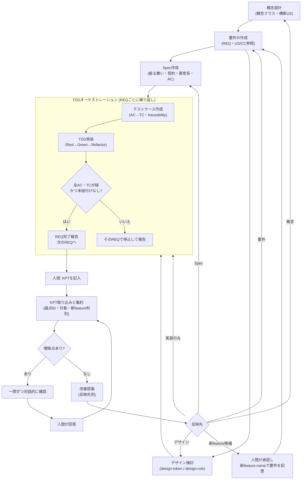

# 概念設計起点・REQ単位TDD・KPTフィードバックの手順書（ツール非依存）

GitHub Copilot Coding Agentという実装手段に依存しない、プロセス自体の説明です。別のツールでこのプロセスを再現する場合はこの文書を参照してください。

具体的なファイル形式・列挙値は各skillファイルとAGENTS.mdを正本とし、ここでは重複定義しません。本書は「何のためにこの手順があるか」と「複数ラウンド・複数featureをどの順で回すか」に焦点を当てます。

## サイクル

1. **概念設計**（機能横断）: 概念クラスと機能横断のユーザーストーリーを記録する。必要になった時点で更新する。
2. **要件の作成**: 要望を受け付け、概念設計（US・CC）を参照して要件（REQ）を作る。REQの並びは処理順（依存するREQを先）とする。
3. **Spec作成・デザイン検討**（並行可）: 各REQの振る舞いをDesign by Contract（事前条件・事後条件・不変条件）で記述し、契約違反時を含む異常系を網羅して、受け入れ基準（AC）を作る。並行して、基本デザインシステム（外部標準・基本トークン）への準拠宣言とfeature独自のデザインルールを**承認なしで適宜**更新する。
4. **REQ単位のTDD**: オーケストレーターがREQごとに次を繰り返す。
   - テストケース作成: 当該REQのACからテストケース（TC）を作り、US〜TCのトレーサビリティを記録する。
   - TDD実装: TCごとにテストを先に書き（Red）、最小実装で通し（Green）、整理する（Refactor）。TCの期待値は実装側が変更せず、誤りはテストケース作成側へ差し戻す。
   - REQ完了の検証: 当該REQの全AC・TCが緑で、トレーサビリティに未紐付けがないことを確認し、REQごとに完了報告する。検証に失敗したREQで停止し、後続REQには進まない。
5. **KPTレビュー**: プロトタイプに触れた人間が Keep / Problem / Try を表（スプレッドシート等）または自由文で記入する。
6. **KPT取り込みと集約**: 取り込んだKPTを、機能カテゴリ別の論点IDを付けたワイド形式（1論点=1行）の表に集約する。論点IDはラウンドをまたいで再利用する。あわせて各論点に「仕様の話か／デザインルールの話か」の区別と、「既存feature改善か／新feature切り出しか」の判別を付与する（迷う場合は仕様／既存feature改善を既定）。ラウンドごとの観測は削除・改変しない履歴として残す。
7. **曖昧点の解消**: 曖昧な点があれば、一問ずつ対話的に（推奨回答を添えて）掘り下げて確認する。同一セッション内で曖昧点がなくなるまで改善提案には進まない。
8. **改善提案とフィードバック**: Try起点で改善案を提示し、反映先（概念設計／要件／Spec／デザイン／実装のみ）別に整理する。反映は**上流から順に**、人間が該当する工程を起動して行う。上流を更新したら、下流（テスト・実装）をその順に更新する。
9. **分岐**:
   - 継続: 反映先の工程を人間が起動し、サイクルを繰り返す。
   - 新feature切り出し: 人間の承認後に新しいfeature-nameで要望を起票し、別ディレクトリとして手順2から新サイクルを開始する。元featureのサイクルはそのまま継続する。

## 設計思想

- **曖昧なまま次工程に進めない**: 人間の記述は省略されがちなため、解釈違いによる手戻りを防ぐ目的で曖昧点の解消を必ず挟む。
- **上流の成果物なしに下流へ進まない**: 概念設計 → 要件 → Spec・デザイン → TDD の順序を守る。KPTで上流に影響する論点が出たら、上流を先に更新する。
- **テストを先に書く**: TCの無い機能・テストの無い実装を追加しない。
- **要件からテストまで追跡できる**: `US → REQ → AC → TC → テストコード`を切らさない。IDは再利用せず、廃止は削除せず状態で表す。
- **起動は人間の判断**: 各工程の起動は人間が行う。KPTの集約結果は反映先を提案するのみで、自動で連鎖しない。
- **デザインルールは承認なしで適宜更新**: 見た目・操作感のルールは承認ゲートを設けない。

## サイクル全体像

登場する「役割」は実装手段に依存しません（Coding Agent運用では`concept-designer`/`requirements-writer`/`spec-writer`/`design-agent`/`tdd-orchestrator`/`test-designer`/`prototype-agent`/`kpt-agent`に対応）。

## 成果物ごとの生成主体・タイミング

| 成果物 | 生成主体 | タイミング | 人間の承認 |
|---|---|---|---|
| docs/knowledge/ のOKF concept-class・user-story | concept-designer役 | 概念設計時・KPTからの反映時 | 不要（明示起動のみ） |
| request.md・requirements.md | requirements-writer役 | 要望受付時・KPTからの反映時 | 明示起動が必要 |
| spec.md | spec-writer役 | 要件確定後・KPTからの反映時 | 明示起動が必要 |
| docs/knowledge/ のOKF design-token・design-rule | design-agent役 | デザイン判断が固まった／変わったとき | 不要（明示起動のみ） |
| test-cases.md・traceability.md（US〜TC列） | test-designer役（オーケストレーター配下） | REQごとのTDD開始時 | 不要 |
| モック・テストコード・prototype-notes.md・traceability.md（実装列） | prototype-agent役（オーケストレーター配下） | REQごとのTDD中 | 不要 |
| kpt-summary.md・clarification-log.md | kpt-agent役 | 毎ラウンド / 曖昧点があるとき | 不要 |
| docs/knowledge/ のOKF glossary-term・system-proposal | kpt-agent役 | 曖昧点解消後、都度 | 不要 |

`requirements.md`・`spec.md`と`docs/knowledge/`（OKF）の非対称性（要件・specは変更履歴を追記、OKFは常に最新のみ保持）が本フローの要点です。

## 複数ラウンド・複数featureの運用

**ラウンド番号はfeature-nameごとに独立したカウンタ**です。1ラウンド = 1回のKPT記入 → 1回の`kpt-agent`役呼び出しが基本単位で、集約結果は「最新スナップショット（上書き）」と「ラウンド履歴（追記専用）」の2つを持ちます。

- **ケースA: 同一featureの反復（基本）**: TDDで実装 → `roundN.csv`を用意 → 同じfeature-nameで`kpt-agent`役を起動 → 曖昧点があれば回答後に改善提案 → 反映先の工程を上流から順に起動 → 次ラウンドへ。feature-nameは変えない。
- **ケースB: 新feature切り出し**: `kpt-agent`役が候補を提示するのみ（自動では何も作らない）。人間が承認して新しいfeature-nameで要件を起票し、手順2から独立して始める。既存featureのループは並行して続く。
- **ケースC: 概念設計の変更**: 概念クラスやユーザーストーリーが変わる場合は、先に概念設計を更新し、影響する要件・Specを上流から順に更新する。変更履歴は要件・Specに追記し、影響するTCは状態を`更新`または`廃止`にする。
- **ケースD: 並行運用時の切り替え**: 起動時に**必ずfeature-nameを指定**する。feature-nameは`docs/specs/<feature-name>/`配下のみを読み書きする一意のキーで、ディレクトリを跨いだ状態は共有されない。指定を誤ると別featureを誤って更新するため、起動のたびに確認する。
